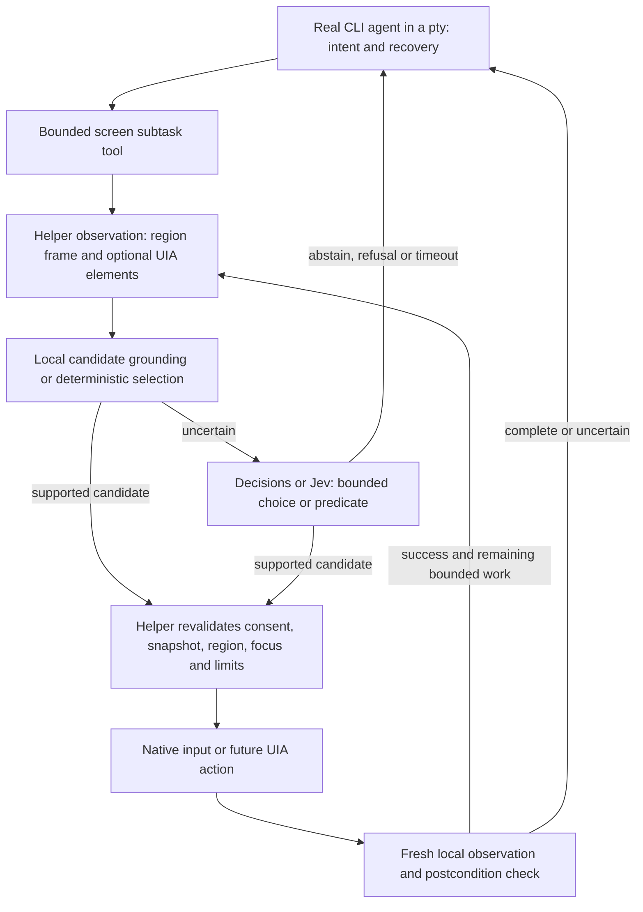

# Fast decision models for Partyline computer use

Research date: **2026-11-07**. Documentation only; no models were downloaded,
no inference was run, and no desktop was controlled. Prices are USD. The supplied
OpenAI and TypeSafe pages, followed by their linked documentation, anchor this
report. Product facts below come from those sources, not assumptions about model
names. Historical GUI models are included as comparison baselines, not a claim
that they are the newest available models.

## Recommendation

Prototype **OpenAI Decisions (`gpt-6-luna`) selecting a supplied action/element**
against **local GUI-Actor-2B grounding the same intent on a frame**. Keep the real
CLI agent responsible for intent, text generation and recovery. Begin with recorded
observations and reversible tasks. Use deterministic accessibility checks before
paying a model to verify an outcome. Add Jev as a text/accessibility-state comparison
when account access is available; test its experimental image path separately.

The promising change is moving recurring, bounded judgments out of the large
agent's screenshot loop. A decision model can choose from actions whose arguments
already exist, or judge observed evidence. It cannot establish that a real action
succeeded without a new observation. Savings can come from keeping those
observations and checks near the helper and returning compact results to the CLI.

## 1. What the two supplied products actually offer

### OpenAI Decisions API

The [announcement, 2026-10-22](https://openai.com/index/decisions-api/) describes
“questions with bounded answers.” It announces general availability using GPT-6
Luna, text/image/JSON inputs, and up to 400 questions per request. The advertised
speedup is **up to 10× versus Luna through Responses**, not versus every computer-use
model. A Sierra testimonial reports **under 280 ms p95** in its orchestration
workload; Speak reports **130 ms time to next action** in a voice integration.
These are vendor-published customer results, not a GUI latency guarantee or a
measurement from this host.

The [developer guide](https://developers.openai.com/api/docs/guides/decisions)
specifies `POST /v1/decisions`, currently with only `model: "gpt-6-luna"`.
`input` carries shared evidence; `questions` supplies named judgments. `predicate`
returns a probability; `choice` selects an allowed value and returns a distribution
and confidence; `score` returns a probability-weighted rubric index. Independent
questions can share a request. Dependent questions require another request.
The application executes the selected action; this endpoint does not operate a
computer or generate arbitrary tool arguments.

Illustrative **proposed Partyline request**, following the
[create-decision schema](https://developers.openai.com/api/reference/resources/decisions/methods/create):

```json
{
  "model": "gpt-6-luna",
  "input": [{
    "role": "user",
    "content": [{
      "type": "input_json",
      "data": {
        "intent": "Open the settings dialog",
        "snapshot_id": "s42",
        "candidates": [
          {"id": "invoke:e17", "role": "button", "name": "Settings"},
          {"id": "invoke:e23", "role": "button", "name": "Help"}
        ]
      }
    }]
  }],
  "questions": [{
    "name": "next_action",
    "type": "choice",
    "instructions": "Choose the candidate that opens settings. Abstain if missing or ambiguous.",
    "choices": [
      {"value": "invoke:e17", "description": "Invoke the Settings button"},
      {"value": "invoke:e23", "description": "Invoke the Help button"},
      {"value": "abstain", "description": "No sufficiently supported action"}
    ]
  }]
}
```

The reference allows **2–255 choices**, **2–10 score levels**, and per-question
refusals. A refusal must route to abstention. A set of 400 questions is not permission
to execute 400 actions: their answers describe the same input state. The JSON above
is an integration design, not an executed request or evidence of GUI accuracy.

The [pricing section](https://developers.openai.com/api/docs/guides/decisions#pricing-and-availability)
lists **$0.10/M input tokens, no output charge**. The
[linked price table](https://developers.openai.com/api/docs/pricing) lists Luna
cache reads at **$0.01/M**, 30-minute writes at **$0.125/M**, and 12-hour writes
at **$0.25/M**, for short context. Regional and long-context multipliers apply.
Cache reuse starts at 1,024 shared-input tokens; question content is outside the
reusable prefix. A changing frame/tree will limit cache hits, so budget uncached
usage first. Check billed usage rather than equating JSON bytes with tokens.

**Not stated in the supplied announcement/linked Decisions guide:** parameter
count, downloadable weights, local VRAM, a Decisions-specific training recipe,
customer fine-tuning support, universal absolute latency/SLA, or scores on
ScreenSpot, ScreenSpot-Pro, OSWorld, WebArena and AndroidWorld. This is a hosted
proprietary service, not a local model license. These sources do not establish
GUI-specific calibration. Prompt examples and threshold selection are not
fine-tuning.

### TypeSafe System One and Jev

The [launch post, 2026-09-15](https://typesafe.ai/blog/introducing-system-one-models-and-jev)
calls Jev “unstructured state in, typed probabilistic decisions out.” It introduces
a decision-oriented architecture, parallel sampling and **Reinforcement Learning
for Calibrated Decisions (RLCD)**. System One borrows the fast/slow distinction
from Kahneman; Jev is named after William Stanley Jevons. Jev is TypeSafe's
served System One model.

The post advertises **70–500 ms end-to-end** and 40–200× speedups for suitable
queries. Its evaluations were generally run from West Coast laptops near the
service. The much-quoted **193.6× faster / 444.6× cheaper** figures come from
its workflow evaluation; reference probabilities are an ensemble of large models,
not independently labeled UI outcomes. The post acknowledges workflow-author and
comparison-method bias. Its Doom demonstration used structured text state, not
images. Treat these as vendor evidence of a useful interface, not reproduced GUI
results.

The [System One concept documentation](https://docs.typesafe.ai/concepts/system-one)
defines a model that evaluates supplied state and returns constrained decisions,
rather than generating replies, code or reasoning explanations. Its calibration
claim concerns groups of predictions, not correctness of each individual answer.
The [AI primer](https://docs.typesafe.ai/introduction/machine-learning-primer)
explains RLCD as optimizing decisions/probabilities against outcomes. It does not
publish enough architecture, training-data or loss-function detail to reproduce
Jev; no linked reproducible training paper was established in this review.

The [current model page](https://docs.typesafe.ai/models), checked on the research
date, lists **`jev-1.14.0`**, released **2026-10-14**, and `jev-1.13.0`.
Both cost **$0.042/M input tokens; outputs are free**. Default limits are **64k
tokens per request / 32k per question**; the documented long-context opt-in raises
both to 262k, with worse speed/accuracy. `jev-latest` currently resolves to 1.14;
pin the version for evaluation. The page explicitly says **no customer fine-tuning
or LoRA adaptation**: all accounts share weights. Customization uses state,
instructions and criteria. Parameter count, downloadable weights, local VRAM and
self-hosting terms are **not stated** there. The served model is proprietary;
an SDK or adapter license is not a license to Jev's weights.

The [HTTP API](https://docs.typesafe.ai/api/system-one) and
[linked OpenAPI specification](https://api.typesafe.ai/openapi.json) expose
`POST https://api.typesafe.ai/v1/systemone`, authenticated with a bearer API key.
Unlike Decisions' question array, `questions` is a **map keyed by question name**.
`state` holds the evidence. A Choice's `criteria` maps allowed values to descriptions;
Score uses ordered criteria; Noul returns the probability of a yes/no condition.
The response includes a named `answers` map, resolved model and usage. The
[quick start](https://docs.typesafe.ai/introduction/quickstart) documents
`TypeSafeClient().system_one(...)` and equivalent direct HTTP requests.

Equivalent **proposed request body** for the same bounded action choice:

```json
{
  "model": "jev-1.14.0",
  "state": {
    "intent": "Open the settings dialog",
    "snapshot_id": "s42",
    "elements": {
      "e17": {"role": "button", "name": "Settings"},
      "e23": {"role": "button", "name": "Help"}
    }
  },
  "questions": {
    "next_action": {
      "type": "choice",
      "instructions": "Choose the action supported by the intent and visible elements.",
      "criteria": {
        "invoke:e17": "Invoke Settings",
        "invoke:e23": "Invoke Help",
        "abstain": "Target missing or ambiguous"
      }
    },
    "target_present": {
      "type": "noul",
      "instructions": "Is an unambiguous Settings control present in elements?"
    }
  }
}
```

The [Choice primitive](https://docs.typesafe.ai/primitives/choice) supports up to
255 options. The [confidence documentation](https://docs.typesafe.ai/confidence)
defines Choice confidence as `(p_max - 1/n) / (1 - 1/n)`. Thus confidence and top
probability are not independent checks. Compare distributions/margins, measure
calibration on our data, and include abstention. Noul has no separate confidence
field. A score's mean can hide conflicting modes; inspect the relevant level's
probability instead of treating its mean as exact arithmetic.

Jev **does now accept images**, although the launch demo did not. The linked
[image documentation](https://docs.typesafe.ai/images) calls images and Box
“Dreamer-ready” and explicitly below production readiness. Each request needs
`TypeSafe-Danger-Zone-Images: true`. Images are PNG/JPEG, with each dimension
280–1568 pixels; WebP helper frames need conversion and small crops need padding.
Images are sent through an `assets` map using multipart or base64, not an assumed
OpenAI image schema. Image tokens cost the input rate, but an image-token estimator
is **not stated**. Repeated asset references can multiply expanded input. These
constraints matter for narrow shared regions and high-resolution desktop controls.

[Box](https://docs.typesafe.ai/primitives/box), added in Jev 1.14, returns normalized
`top/bottom/left/right` edges for one target. It has **no not-found result**: pair
it with a presence Noul and reject absent/ambiguous targets. The Box page documents
a numeric confidence, while the linked OpenAPI example/schema permits a null
confidence; a prototype should treat missing/null confidence as unknown. No GUI
benchmark or trustworthy click-accuracy threshold was established for Box.

Type safety is useful but does not make the selected answer true. The
[jaggedness page](https://docs.typesafe.ai/model-jaggedness) documents literal
interpretation, numeric errors, indirection, irrelevant-context degradation,
adversarial content and option-order sensitivity. These qualifications narrow the
launch post's “can’t hallucinate” claim: Jev can choose a valid but wrong
element. Keep screen text as untrusted evidence and test distractors, missing
targets and candidate permutations.

### Practical comparison of the anchors

| Property | OpenAI Decisions | Jev 1.14 |
| --- | --- | --- |
| Best first Partyline use, our assessment | Choose an existing action/element; predicate over observed state | Same; particularly compact text/UIA state |
| Arbitrary generated text/coordinates | No general generation; coordinates could only be supplied choices | No text generation; experimental Box supplies coordinates |
| Images | Documented endpoint input | Experimental opt-in, strict dimensions/formats |
| Model adaptation | Fine-tuning not stated for this endpoint | Customer fine-tuning explicitly unavailable |
| Model-call latency | Up to 10× Luna Responses; customer-specific subsecond results | Vendor 70–500 ms; deployment-dependent |
| GUI benchmark evidence | Not stated | Not stated |
| 2,000 uncached input tokens/request, calculated | $0.000200 | $0.000084 |
| Deployment | Hosted; proprietary, size/VRAM not stated | Hosted; proprietary, size/VRAM not stated |

Neither product is demonstrated by these sources to predict future screen states.
Their useful contract is a bounded decision over evidence. A settled-screen
predicate is a judgment about observations, not a learned simulator.

## 2. Comparable models and services

### Reading the numbers

**NR** means no relevant score was verified in the cited primary sources, not zero.
**NS** means not stated there. **E** marks our memory estimate, not measured VRAM.
Model sizes below use published names, which can exclude vision components.
For dense models, BF16 weights alone are roughly `2 × parameters` bytes; inference
also needs vision activations, caches and framework memory. Image resolution,
context, batching and quantization change both accuracy and memory.

All local rows have **$0 API fee per decision**, plus hardware/electricity and any
training cost. All their Partyline latency figures are **unmeasured**. Published
throughput without matching hardware/resolution is not a per-action guarantee.
The memory ranges below assume batch one and bounded image/context sizes, not
training. A 7B model's name alone does not guarantee it fits a 24 GiB GPU.

### Open GUI specialists: deployment and fit

| Model/version and primary source/date | Role | License evidence | Size; estimated inference VRAM | Latency evidence / fit |
| --- | --- | --- | --- | --- |
| [UI-TARS-1.5-7B](https://github.com/bytedance/UI-TARS), 2025-04-16 | Full visual action policy, with reasoning | [Weights Apache-2.0](https://huggingface.co/ByteDance-Seed/UI-TARS-1.5-7B) | 7B nominal; E 18–24+ GiB BF16, 8–12 GiB at 4-bit | NS comparable per-step latency; useful later policy baseline, more generation than a grounding head |
| [OS-Atlas](https://github.com/OS-Copilot/OS-Atlas), [paper 2024-10](https://arxiv.org/abs/2410.23218) | Base grounding; Pro action model | [7B card Apache-2.0](https://huggingface.co/OS-Copilot/OS-Atlas-Base-7B); check backbone for each variant | 4B / 7B; E 10–14 / 18–24+ GiB BF16 | NS; normalized coordinates need exact frame transform |
| [ShowUI](https://github.com/showlab/ShowUI), [paper 2024-11](https://arxiv.org/abs/2411.17465) | Small visual action model, token selection | [2B weights MIT](https://huggingface.co/showlab/ShowUI-2B) | 2B; E 6–8 GiB BF16 | NS matched per-step latency; compact comparison |
| [UGround-V1](https://github.com/OSU-NLP-Group/UGround), 2025-01-03 release | Instruction-to-point grounding; needs planner | [7B weights Apache-2.0](https://huggingface.co/osunlp/UGround-V1-7B) | 2B/7B/72B; E 6–8 / 18–24+ / 150–180 GiB BF16 | NS; directly supports planner/grounder split |
| [GUI-Actor](https://github.com/microsoft/GUI-Actor), [paper 2025-06](https://arxiv.org/abs/2506.03143) | Attention-based grounding head, optional grounding verifier | MIT [code](https://github.com/microsoft/GUI-Actor/blob/main/LICENSE) and [2B card](https://huggingface.co/microsoft/GUI-Actor-2B-Qwen2-VL) | Qwen2-VL 2B/7B; Qwen2.5-VL 3B/7B; E 6–8 / 8–12 / 18–24+ GiB BF16 by size | NS matched latency; first local choice for a narrow action head |
| [OmniParser v2](https://huggingface.co/microsoft/OmniParser-v2.0), 2025-02 | OCR/icon parsing into numbered elements, not a policy | Original YOLOv8 detector AGPL-3.0, captioner MIT; newer `icon_detect_v3` + captioner is MIT | Detector + Florence-2-base + OCR; total NS; E allow 4–8 GiB, measure | Card reports **0.6 s/frame A100, 0.8 s RTX 4090**; parsing only, excludes deciding/executing |
| [SeeClick](https://github.com/njucckevin/SeeClick), [paper 2024-01](https://arxiv.org/abs/2401.10935) | Older grounding/action baseline | Code Apache-2.0; checkpoint/backbone original terms also apply | 9.6B; E 24–32 GiB BF16 | NS; historical rather than first deployment choice |
| [Aguvis](https://github.com/xlang-ai/aguvis), [paper 2024-12](https://arxiv.org/abs/2412.04454) | Pure-vision policy and grounding | License for selected [7B-720P weights](https://huggingface.co/xlangai/Aguvis-7B-720P) **not stated** on fetched card; verify before use | 7B/72B nominal; E 18–24+ / 150–180 GiB BF16 | NS; no automatic permission inference from open weights |
| [CogAgent](https://github.com/zai-org/CogAgent), 9B release 2024-12-20 | Visual execution policy | Code Apache-2.0; [weights custom CogAgent terms](https://github.com/zai-org/CogAgent/blob/main/MODEL_LICENSE), commercial registration and other conditions | 9B current baseline, 18B original; vendor **29 GB minimum BF16 for 9B**, about 8 GB INT4 with quality warning | NS; BF16 9B does not fit this 4090 |
| [Ferret-UI](https://arxiv.org/abs/2404.05719), 2024-04; [UI 2](https://arxiv.org/abs/2410.18967), 2024-10 | UI referring/grounding/reasoning | Selected UI checkpoint license not verified; [Ferret repo](https://github.com/apple/ml-ferret) has research/noncommercial restrictions, not blanket commercial permission | Original 7B/13B paper configurations; E 18–24+ / 30–40 GiB BF16 | NS; primarily UI understanding; exact checkpoint availability/terms need recheck |

Quantized memory numbers are planning estimates, not a recommendation to accept
their accuracy. No installation or quantized checkpoint was validated here.
OmniParser's new detector license does not establish that the old latency/accuracy
measurements transfer to that detector.

### GUI benchmark evidence

ScreenSpot/ScreenSpot-v2 measure target grounding, not task completion.
ScreenSpot-Pro stresses professional high-resolution interfaces. OSWorld and
WebArena measure end-to-end desktop/web tasks; AndroidWorld uses Android tasks.
Do not substitute WebVoyager, Online-Mind2Web, Mind2Web or AITW for these benchmarks.
Original OSWorld and OSWorld-Verified are different test versions. Step limits,
planner, image scale and verifier calls must accompany any comparison. See
[ScreenSpot-Pro's benchmark repository](https://github.com/likaixin2000/ScreenSpot-Pro-GUI-Grounding),
[OSWorld](https://github.com/xlang-ai/OSWorld),
[WebArena](https://github.com/web-arena-x/webarena), and
[AndroidWorld](https://github.com/google-research/android_world).

| Exact model/system | ScreenSpot / v2 % | ScreenSpot-Pro % | OSWorld % | WebArena % | AndroidWorld % |
| --- | --- | --- | --- | --- | --- |
| UI-TARS-1.5-7B, released | NR / NR | **49.6** | **27.5**, model-scale table | NR | NR |
| UI-TARS-1.5, larger research system, not the released 7B | NR / **94.2** | **61.6** | **42.5**, 100 steps | NR | **64.2** |
| OS-Atlas-7B, GUI-Actor authors' comparison | **82.5 / 84.1** | **18.9** | NR | NR | NR |
| ShowUI-2B, original paper | **75.1** / NR | NR | NR | NR | NR |
| UGround-V1-7B, GUI-Actor comparison | **86.3 / 87.6** | **31.1** | NR | NR | NR |
| GUI-Actor-2B, Qwen2-VL | **86.5 / 88.6** | **36.7** | NR | NR | NR |
| GUI-Actor-2B + grounding verifier | **86.9 / 89.3** | **41.8** | NR | NR | NR |
| GUI-Actor-7B, Qwen2.5-VL | NR / **92.1** | **44.6**, **47.7** with verifier | NR | NR | NR |
| OmniParser-v2 system, model-card claim | NR / NR | **39.6** | NR | NR | NR |
| SeeClick-9.6B, original repo | **53.4** / NR | NR | NR | NR | NR |
| Aguvis-7B, GUI-Actor comparison | **84.4 / 86.0** | **22.9** | NR | NR | NR |
| CogAgent-9B / Ferret-UI selected versions | NR / NR | NR | NR | NR | NR |
| Decisions / Jev | NR / NR | NR | NR | NR | NR |

Sources: [UI-TARS model-scale and main tables](https://github.com/bytedance/UI-TARS#performance),
[GUI-Actor tables](https://github.com/microsoft/GUI-Actor#-main-results),
[ShowUI original paper](https://openaccess.thecvf.com/content/CVPR2025/papers/Lin_ShowUI_One_Vision-Language-Action_Model_for_GUI_Visual_Agent_CVPR_2025_paper.pdf),
[OmniParser card](https://huggingface.co/microsoft/OmniParser-v2.0), and
[SeeClick results](https://github.com/njucckevin/SeeClick#evaluation-results).
GUI-Actor's comparison explicitly marks its own reruns for UGround/Aguvis v2;
those are not identical to each project's original protocol. UGround's own table,
for example, reports 81.0 for OS-Atlas-Base-7B in its standard setting. Scores are
published evidence, not reproduced results. GUI-Actor's verifier checks a proposed
grounding, not whether an executed UI action succeeded.

### Hosted computer-use models

All rows are proprietary hosted inference: weights, parameter counts and local
VRAM are **NS**. They return suggested actions for a client tool to execute.
They are heavier alternatives/escalation targets, not equivalent to a bounded
classifier. Operator is the historical product built on CUA, not a separate
pay-per-action model license.

For cost comparison, **C** means one uncached request with 2,000 billed input
tokens and 100 billed output tokens, no extra tools/environment fees. This is an
arithmetic scenario, not a measured screenshot/action price. Thinking, retries,
history and image tokenization may increase the bill; a request can contain more
than one action.

| Service/version | API and availability evidence | Token prices input/output per M; calculated C | Latency and benchmark evidence |
| --- | --- | --- | --- |
| Anthropic computer use, pinned Sonnet 4.6 baseline | [Tool docs](https://platform.claude.com/docs/en/agents-and-tools/tool-use/computer-use-tool) describe client-executed tool calls and earlier versions; [4.6 page](https://platform.claude.com/docs/en/models/sonnet-4-6/overview) labels this model legacy | $3/$15; **$0.0075** | Per-action latency NS; [2026-02-17 system card](https://www-cdn.anthropic.com/bbd8ef16d70b7a1665f14f306ee88b53f686aa75.pdf): **72.5% OSWorld-Verified**, 100 steps, 1080p, five-run mean. Other requested scores NR |
| OpenAI CUA / `computer-use-preview`, historical | [Model page](https://developers.openai.com/api/docs/models/computer-use-preview) now explicitly says **Shut down**; do not select for a new prototype | Historical $3/$12; **$0.0072**, not a currently purchasable quote | [CUA launch, 2025-01-23](https://openai.com/index/computer-using-agent/): **38.1% OSWorld**, **58.1% WebArena**. Not transferable to a later model; matched step latency and other requested scores NR |
| OpenAI current computer tool, GPT-6.1 Sol | [Current guide](https://developers.openai.com/api/docs/guides/tools-computer-use) uses `gpt-6.1-sol` and `computer` with client-supplied results | [Model card](https://developers.openai.com/api/docs/models/gpt-6.1-sol) $2/$10; **$0.0050** before applicable tool/hosting charges | No matched per-action latency or requested GUI scores established by these docs; do not inherit CUA's launch scores |
| Gemini computer use, current recommended Gemini 3.8 Flash | [Current guide](https://ai.google.dev/gemini-api/docs/computer-use) recommends `gemini-3.8-flash`; also lists 3.5 Flash-Lite and 3 Flash Preview | [Pricing](https://ai.google.dev/gemini-api/docs/pricing#gemini-3.8-flash) $0.75/$3.75 through 2026-12-31; **$0.001875**. Prices double 2027-01-01 | Matched per-action latency and requested benchmark scores NR for this version |
| Gemini 2.5 Computer Use, historical 2025-10 preview | [Launch, 2025-10-07](https://blog.google/innovation-and-ai/models-and-research/google-deepmind/gemini-computer-use-model/) reports browser/mobile capability | Current live guide uses newer models; exact usable legacy endpoint/rate **not established** here | Launch compares AndroidWorld, WebVoyager and Online-Mind2Web. No score transcribed from chart-only content; qualitative latency comparison is not per-action data |

### Smaller decision models in the same spirit

| Option | License; local/hosted; memory | Cost/decision and latency | Training, evidence and limits |
| --- | --- | --- | --- |
| [SetFit](https://github.com/huggingface/setfit) with [all-MiniLM-L6-v2](https://huggingface.co/sentence-transformers/all-MiniLM-L6-v2) | SetFit Apache-2.0, selected encoder Apache-2.0; local, about 22.7M encoder parameters; CPU possible, E below 1 GiB inference | $0 API; matched latency NS | [2022-09 paper](https://arxiv.org/abs/2209.11055) and [docs](https://huggingface.co/docs/setfit/main/en/index) demonstrate few-shot classification. Needs Partyline labels; no requested GUI scores. Good candidate for `success/failed/unknown` on compact UIA summaries, not pixel grounding |
| [ModernBERT-base](https://huggingface.co/answerdotai/ModernBERT-base) + classifier/ranker | Apache-2.0; local, 149M; E 0.3 GB BF16 weights, 1–2 GiB inference budget for short inputs | $0 API; matched latency NS | [2024-12 paper](https://arxiv.org/abs/2412.13663); needs a trained head. [Cross-encoder training](https://sbert.net/docs/cross_encoder/training_overview.html) provides an established recipe for scoring intent/candidate pairs. No requested GUI scores; base masked LM is not a ready action policy |
| Local numeric classifier (logistic regression or tree model) on UIA/delta features | Implementation/library license-dependent; CPU, no VRAM requirement | $0 API; latency must be measured, likely cheap enough to test first | Requires task-specific labels; use for settle/progress features rather than open-ended intent. Probability calibration needs held-out data |
| [TypeSafe's System One Adapter](https://github.com/typesafe-ai/system-one-adapter-python) over an ordinary LLM | Wrapper, not Jev weights; provider's license/hosting/memory applies | Provider input/output rates, retries and generation latency; NS single price | Gives a common question interface for experiments. Generated probability strings and schema validation do not reproduce RLCD or prove calibration; no requested GUI scores |

## 3. Decision policies, training and verification

“Decision model” here describes the input/output contract. It does not by itself
mean a Decision Transformer, reinforcement-learned UI policy, world model, or a
model trained on Partyline trajectories. Decisions and Jev offer zero-shot
semantic judgments; a local classifier needs representative labels.

[Decision Transformer, 2021-06](https://arxiv.org/abs/2106.01345) conditions an
action sequence on states, past actions and desired return. It is a training
approach, not an off-the-shelf screen-control model. UI use would need a state
encoder, action vocabulary and logged trajectories with rewards. Sparse terminal
success and deployment changes make naive reuse difficult. Start with supervised
intent/element ranking and abstention; only investigate return-conditioned
policies after collecting useful trajectories.

[DigiRL, 2024-06](https://arxiv.org/abs/2406.11896), with
[released code](https://github.com/DigiRL-agent/digirl), already combines offline
initialization and online reinforcement learning for device-control agents.
It is evidence that policy/value training and autonomous feedback are established,
not evidence that Partyline needs online RL on a person's desktop. Offline RL
also depends on coverage: a policy/value model can be confidently wrong about
actions absent from its logs. A small learned action head is attractive when it
can rank supplied candidates; it still needs grounding and a fresh-state check.

Use a **verification ladder**, proposed for Partyline:

1. **Execution receipt:** did the helper accept/finish/interruption-check the action?
   An input-injection acknowledgment is not task success. An unconfirmed action
   is unknown, not a reason to blindly repeat a click or submit.
2. **Deterministic observation:** verify a UIA toggle/value/window/focus change,
   or an expected dialog/title/element. Detect stable frame/tree deltas with a
   bounded wait. Keep arithmetic and timing in code. “No visible change” can mean
   a missed action, a finished action, a hung app, or a background operation.
3. **Cheap semantic judgment:** Decisions predicate / Jev Noul over the actual
   post-action tree or before/after images: “Is the Settings dialog now visible?”
   Include explicit `unknown` behavior when evidence is incomplete. A local
   classifier can eventually replace recurring checks once labeled.
4. **CLI escalation:** unexpected dialog, disagreement, low confidence, missing
   target, timeout or goal change returns evidence and control to the CLI agent.

For settling, prefer native events plus stable semantic state over asking a cloud
model on every video frame. Animation can continue after a UI is usable; an
unchanging spinner can be unfinished. A cheap model may adjudicate those cases,
but only fresh observations can support the judgment. This reduces **large-model
round trips**, not the need to observe the actual computer. A paid verifier still
has its own network round trip and may receive image data.

Validate action selection and verification separately. Measure selective error
rate versus coverage, reliability diagrams/Brier score, false-success rate,
candidate-order sensitivity and generalization to unseen layouts. Agreement of
two prompts to one model is not independent evidence. Calibrate by model version,
task class and input modality; do not turn vendor confidence into a blanket
permission to act.

## 4. Proposed Partyline architecture and boundaries

The current implementation described in [screen-helper.md](../screen-helper.md)
already has separate share/control consent, a shared rectangle, physical-input
revocation, a kill switch, frame scaling, limits and audit records. Actions return
a fresh frame after a 0.3-second settle; capture defaults to at most 1 FPS and
1280 pixels on the long edge. A model wrapper alone cannot remove these existing
protocol costs. Batching, delta summaries, settle/wait and Windows UI Automation
are **planned capabilities from the brief**, not features assumed present in this
checkout.



The following are proposed contracts, not new tool names implemented by this doc:

- The CLI supplies a bounded intent, precomputed text/arguments, expected
  postcondition, action budget and deadline. It owns planning and prose. The
  specialist chooses a **complete candidate action**, not independent verb/target
  fields that could form an invalid combination. It can always abstain.
- Each candidate is tied to `share_id`, region, frame/tree snapshot, time and
  device scale. A future UIA element number is snapshot-local, not a permanent
  identity. The helper re-resolves it and verifies visibility, enabled state,
  bounds and focus just before execution. Reject stale responses after a resize,
  popup, human input or a new share; do not reuse coordinates across screenshots.
- Windows UIA enumeration and action-pattern support belong on the **helper**.
  Number only permitted visible elements within the shared region; redact/filter
  unrelated tree content before sending it. Password values, hidden windows and
  off-region metadata must not leak through a richer tree. Pixel fallback handles
  canvases and inaccessible applications. An element action still obeys the
  region and control grant; native accessibility access must not become a way
  around those limits.
- Place optional inference behind the helper or behind a CLI-invoked tool.
  A GPU host can serve inference to an authorized helper without being the
  controlled desktop. Partyline's server transports capability-neutral observations,
  requests and receipts; it does not acquire provider-specific client behavior.
  This preserves **“Partyline knows no client.”**
- **Every attached agent remains a real interactive CLI in a pty.** A model API
  is an implementation detail of an explicitly invoked tool, not an SDK/headless
  replacement for an attached agent. Tool results are evidence; public assistant
  speech still comes from that CLI's structured transcript, never terminal scrapes
  or model-service output impersonating an attachment. See [agent rules](../agent-rules.md).
- Existing consent, focus-before-typing, blocked key combinations, action limits,
  revocation and audit remain authoritative **before every action**, including
  each action inside a future batch. Physical input discards queued/in-flight
  model decisions. Model confidence cannot grant control. Cloud inference must
  use an explicitly configured permitted provider/data path; shared-screen
  consent is not an implementation excuse to forward unrestricted desktop data.
- At first, execute only one action before checking its postcondition. Later allow
  small batches with a guard between steps and a local observation at any state
  boundary. Return a compact action/result summary; include a frame on failure,
  uncertainty, planned checkpoints or request. Preserve auditability even when
  the large model receives fewer images.

The current helper audits a prefix of typed text. A prototype should use synthetic
content and explicitly decide what additional model input/results are retained.
Provider prompts, tool responses and UI labels are data, never authorization.

## 5. What is already done, and what could be new

**Already published/productized:** typed probabilistic questions and confidence
gates are the two anchor products' core offering. TypeSafe directly documents
[confidence routing](https://docs.typesafe.ai/patterns/confidence-routing),
[companion presence checks](https://docs.typesafe.ai/patterns/companion-noul),
and a [cheap-model / Jev verifier / reasoning-model cascade](https://docs.typesafe.ai/cookbooks/sde_cascade).
Calling that general cascade a new invention would be wrong.

Planner/grounder separation is also established by UGround and related visual
agents; GUI-Actor already uses a dedicated grounding head and verifier. RL device
policies predate these products. Accessibility-based control and semantic action
selection are established techniques. Replacing text generation with a bounded
decision is an implementation choice with strong precedents.

**Potential Partyline contribution, not a proven research novelty:** a
client-independent, consent-bound execution layer that compares probabilistic
semantic decisions with fresh UIA/visual outcomes, learns when to abstain, and
reduces screenshot delivery to the large pty agent while preserving immediate
human takeover. The useful experiment is whether this combination improves
**cost and latency at fixed task success and false-success rate**. A general claim
of first use of System One models for GUIs is unsupported by this search.

The novel hypothesis worth testing is narrower: **small bounded decisions plus
local postconditions can eliminate most large-agent observation turns without
increasing undetected failures**. That needs an ablation against batching/UIA
alone. Otherwise infrastructure improvements could be mistaken for model gains.

## 6. Smallest useful prototype, hardware and budget

### Available hardware

Read-only checks on **2026-11-07 at 19:52 UTC** returned:

| Check | Observed result |
| --- | --- |
| `nvidia-smi` | NVIDIA GeForce RTX 4090, **24,564 MiB** total, **843 MiB** used, GPU utilization 0% |
| Driver / advertised CUDA compatibility | **595.99.02 / 13.2**; this does not establish a working PyTorch/CUDA installation |
| `free -h` | **61 GiB** RAM total, **51 GiB** available, 8 GiB swap |
| Desktop evidence | `kwin_wayland` and `Xwayland` were listed as GPU processes; CLI session display variables were empty |

A 2B grounder is a plausible comfortable fit; begin with **GUI-Actor-2B-Qwen2-VL**
in BF16, batch one, bounded image size/context, E 6–8 GiB. Reserve memory for the
desktop and other workloads. Serving and especially training may exceed an
attached process's ordinary memory budget: arrange an explicit resource lease and
appropriate capped worker before any future run. No GPU allocation was made for
this research. Do not infer that this machine can train a full GUI policy.

The server's GPU is not proof the controlled desktop is compatible. This checkout's
helper refuses Wayland. Use recorded frames first, then an explicitly shared
Windows desktop for UIA, or a supported X11 test desktop. Do not promise local
live capture based on the 4090 alone.

### Experiment design

1. **Recorded, matched decisions first.** Collect 200 labeled intent/state pairs
   from synthetic settings/forms/dialog tasks with authorized recordings, including
   absent targets, duplicate labels, stale layouts, popups and irrelevant text.
   Keep a frame, timestamp, allowed candidates and expected postcondition. A
   manually labeled element list is sufficient until UIA exists. Split by task
   template/application/layout: 100 development, 100 held out, not adjacent frames
   from the same trajectory on both sides. This sizes an exploratory test, not a
   benchmark-quality safety claim.
2. **One paid / one local.** Run Decisions `gpt-6-luna` on the candidate list,
   optionally with the frame, and GUI-Actor-2B on the same intent/frame. Score
   target-hit accuracy and abstention separately; map a local point to a candidate
   only if it lies in exactly one permitted target. GUI-Actor's attention score is
   not assumed to be a calibrated choice probability. Keep text-only and visual
   Decisions results separate, and include candidate-generation failures.
3. **Verify independently.** Build before/after examples labeled
   `success/failed/unknown`; inject no-ops, delayed dialogs and interrupted typing.
   Compare deterministic checks with Decisions predicates. An optional Jev text
   trial uses `jev-1.14.0` with the same candidate choices. Only evaluate Jev Box
   behind its documented image opt-in, with presence checking and no live actions
   at first. This is an extension, not a prerequisite for the first result.
4. **Then 30 reversible live tasks**, each 3–5 actions, on a consenting test desktop.
   Retain the current helper's action/frame behavior initially. Compare the
   current CLI baseline, UIA/deterministic execution alone when available, and
   the cascade. Use matched seeded tasks and the same stop rules. Future batching
   and delta-summary changes are separate experimental factors, not hidden parts
   of a claimed model speedup. Never test purchases, publishing or destructive
   operations as convenient success oracles.

Measure client-observed **p50/p95** from observation availability to accepted
decision, and from action request to verified postcondition. Break out inference,
upload/network, helper execution, settle, verification, model load/cold start and
retries. Report screenshots/bytes reaching the CLI separately from local captures
and paid-model uploads; reducing CLI images alone need not reduce total traffic.
Record token usage, API dollars, local GPU time/peak VRAM, task success, extra
actions, escalation fraction and wrong-target/false-success counts.

**Proposed go/no-go targets**, not observed performance:

- At least **95% correct accepted target choices** at **60% or higher coverage**
  on held-out examples; abstain/escalate on ambiguous or stale state.
- At least **50% fewer large-CLI screenshot turns** and **30% lower median task
  time**, with task success no more than five percentage points below the matched
  baseline. Report uncertainty; 30 tasks cannot establish a small difference.
- Decision p95 **under 750 ms** for compact state, excluding the existing capture/
  settle delay. This is a prototype target to measure from this network, not a
  promised API latency.
- **Zero observed false-success decisions, out-of-region actions, actions after
  revocation, or unreviewed irreversible actions.** Report denominators: even zero
  false successes in 100 checks leaves an approximate 3% upper 95% bound. More
  trials are needed before claiming reliability at a much lower error rate.

### Cost calculation

There is no universal cost per click: price follows **billed input, questions,
images, retries and output**, not the helper's action counter. For the two anchors,
uncached request cost is `input_tokens × rate / 1,000,000`; outputs are free.
The following assumes 2,000 **total** billed input tokens per request, including
questions, no regional/long-context premium, no cache, and no extra tool charges:

| Scenario, calculated | Decisions | Jev |
| --- | --- | --- |
| One 2,000-token decision request | $0.000200 | $0.000084 |
| 200 selections + 200 separate verifications = 400 requests | **$0.0800** | **$0.0336** |
| 10,000 actions, one selection + one verification each | **$4.00** | **$1.68** |
| 10 decisions/second for one hour, one request per decision | **$7.20** | **$3.024** |

The Jev launch's roughly $7/hour Doom example has a different workload size;
it is not inconsistent with this explicitly hypothetical 2,000-token calculation.
Do not double-count shared input per question in one request, but do count all
question/criteria tokens and repeated evidence actually billed. Dependent
selection and post-action verification necessarily have different observations.

Reserve **$5 for the Decisions pilot**, with a hard request/token budget, allowing
larger image inputs and retries. Allow an additional **$5–$10 for paid CLI/API
baseline comparisons**; subscription-backed CLI usage cannot be converted to a
universal marginal API bill. Actual image token counts must come from usage.
No accounts were charged during this research.

Local inference has no API fee. At an assumed incremental average **150–450 W**,
one hour uses **0.15–0.45 kWh**; at an illustrative **$0.20/kWh** that is
**$0.03–$0.09/hour**, excluding idle host power, capital and engineering. This is
an energy scenario, not this host's measured inference consumption or tariff.
Allow one to two engineering days for replay/instrumentation once observations
and access exist; helper/UIA/protocol implementation is additional work. Train
nothing initially. If recurring labels later justify it, distill a small local
ranker/verifier with human-checked labels and keep an untouched application split.

## 7. Claims still requiring verification

- Product speed/calibration claims were not independently reproduced. Neither
  anchor supplies the requested GUI scores; exact UI grounding and postcondition
  error rates are unknown.
- OpenAI Decisions' training internals, customer fine-tuning and parameter count
  are not stated in the reviewed product documentation. Jev states its training
  family and customization limits, but not reproducible internals or model size.
- Jev account access, organization rate limits and actual latency from this host
  need an authenticated experiment. Image/Box readiness and null-confidence
  handling need version-specific tests. OpenAI regional/caching costs also need
  billed-usage confirmation for the chosen account.
- Local VRAM ranges are estimates except the explicitly attributed CogAgent and
  OmniParser statements. Checkpoint availability, compatible runtimes and licenses
  must be pinned before downloading, especially Aguvis/Ferret variants and older
  detectors/backbones.
- Hosted pages change quickly. The shut-down CUA preview, legacy Sonnet model,
  and newer Gemini tool documentation show why historical scores and current
  endpoint names must not be mixed. All comparisons require pinned model/version,
  harness, action budget, resolution and date.

The research supports an inexpensive, bounded-action experiment. It does not yet
support replacing the CLI planner, skipping real outcome observations, or claiming
a new general computer-use algorithm.
